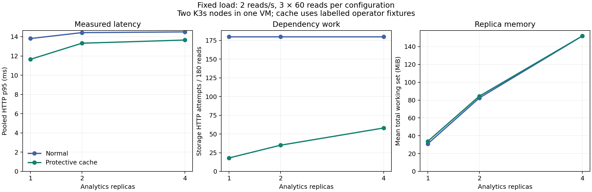

# Final laboratory validation, 22 November 2026

The current scenario-1 and scenario-2 flows completed with exit code zero.
Their original logs, HTTP observations, metrics and restoration evidence are
retained below. The separate replica experiment uses ordinary, bounded reads.
The academic report is supplied separately.

## Scenario 1: admission, cache response and recovery

[Full flow](../evidence/scenarios/01-dos/demo-flow-20261122T130556Z-102201/flow.log)
contains the unprotected temporary clone, cleanup and protected production trial.
[Detailed response evidence](../evidence/scenarios/01-dos/demo-flow-20261122T130556Z-102201/protected-evaluation/summary.json)
retains the paired windows and linked Wazuh records.

| Observation | Normal window | Protective-cache window |
|---|---:|---:|
| Manual HTTP 200 reads | 30/30 | 30/30 |
| Manual cache hits | 0 | 24 |
| Manual mean latency | 19.809 ms | 5.706 ms |
| Manual p95 latency | 46.626 ms | 10.529 ms |
| All-client admitted reads | 48 | 48 |
| All-client Storage HTTP attempts | 48 | 6 |
| Storage attempts / admitted read | 1.000 | 0.125 |

The controlled 15-request admission check returned five HTTP 200 and ten HTTP
429 responses. Wazuh activation and reversal were retained with rules `100121`
and `100130`. The protective lease expired; two recovery reads returned normal,
uncached HTTP 200. Production specs, Pod identities and restart counts stayed
unchanged. The maximum protective data age was 4.434 seconds.

Storage HTTP attempts decreased by 87.5% for these equally admitted windows.
The counter measures attempted dependency calls, not individual SQLite reads.
This establishes policy enforcement and reduced dependency work for this trial;
it does not establish saturation resistance.

An initial execution exposed an incorrect demonstration assertion: all manual
reads were required to be cache hits despite the five-second refresh TTL.
The flow now requires actual cache hits and fewer Storage attempts per admitted
read. Regression tests cover valid refreshes, no cache use and no dependency-work
reduction. The complete flow was then repeated successfully.

## Scenario 2: real DNS-record edit, rejection and restoration

[Full flow](../evidence/scenarios/02-dns-hijacking/demo-20261122T131141Z-106689/flow.log),
[response audit](../evidence/scenarios/02-dns-hijacking/demo-20261122T131141Z-106689/restoration-audit.json),
[manager alerts](../evidence/scenarios/02-dns-hijacking/demo-20261122T131141Z-106689/manager-alerts.jsonl)
and [postflight](../evidence/scenarios/02-dns-hijacking/demo-20261122T131141Z-106689/postflight.log)
retain the original observations.

1. The approved answer was `10.255.255.74`.
2. One controlled configuration edit changed it to the labelled fake endpoint,
   `10.171.72.52`, while protection was stopped for the comparison.
3. Eight measured guarded checks rejected the unexpected answer before HTTP.
   Prometheus reported `DNSPolicyRejections` in firing state.
4. After protection resumed, the queued bridge episode dispatched Wazuh rule
   `100151` and the response audit recorded restoration of the changed file.
5. The resolver returned `10.255.255.74`; a guarded Analytics read returned
   HTTP 200 from that peer. The current and approved file hashes matched, and
   the Wazuh agent and guarded client were active.

The startup command returned `already_approved`: this execution demonstrates
the bridge response, not an independent `100145` startup activation. The flow's
step title names the startup check but does not identify the winning response
when the two paths race. Earlier dedicated startup evidence remains separately
linked in the [scenario documentation](scenarios/02-dns-hijacking/README.md).

The [correlation record](../evidence/scenarios/02-dns-hijacking/demo-20261122T131141Z-106689/correlation.json)
records a logging discrepancy: the response reports alert ID
`1795353146.16198514`, while the indexed `100151` bridge event is
`1795353146.16199416`. The bridge episode, timing, scope, file hashes and recovery
agree. The reported ID points to an operational mail notification, so it must
not be presented as an exact indexed-alert match. The cause is not established
by this trial. The original records are preserved unchanged.

Before this DNS trial, a disconnected monitoring fixture from 20 November was
removed. Its localhost exporter no longer existed and produced a stale
`DNSExporterUnavailable` alert. The real DNS target remained configured;
Prometheus configuration validation and reload passed. The
[retirement record](../evidence/validation-20261122-final-flows/dns-orphan-retirement.json)
retains the change. Scenario 1's earlier API history can still contain that old
alert; it is not evidence of a DNS fault in the final DNS trial.

## Replica experiment

The reusable [script and instructions](../tests/scalability/README.md) live under
`tests/scalability/`. It compares 1, 2 and 4 temporary Analytics replicas using
the production image and resource limits. Rate limiting remains enabled.
Each normal/cache configuration receives three repetitions of 60 reads at a
maximum scheduled rate of two requests per second, for 1,080 measured reads.
The study alternates mode order and retains all individual responses, per-Pod
counter deltas, kubelet resource samples, source hashes and cleanup records.

Cache mode uses labelled operator fixtures in dedicated temporary node paths.
The experiment measures replica behavior; the scenario-1 flow supplies the
separate proof of real Wazuh activation. All nodes share one VM and one
Storage/SQLite dependency. A final fixture on only one node tests state scope.

All 18 trials completed successfully: **1,080/1,080 measured HTTP 200** responses,
with correct modes, no candidate restarts and a maximum data age of 4.988 seconds.
Each row below summarizes 180 reads per mode across three repetitions.

| Replicas | Normal p95 ms | Cache p95 ms | Storage attempts, normal / cache | Cache hits | Working set MiB, normal / cache |
|---:|---:|---:|---:|---:|---:|
| 1 | 13.807 | 11.648 | 180 / 18 | 162/180 | 30.99 / 33.80 |
| 2 | 14.424 | 13.323 | 180 / 35 | 145/180 | 82.40 / 84.47 |
| 4 | 14.498 | 13.653 | 180 / 58 | 122/180 | 151.98 / 152.01 |

The cache reduced Storage calls by 90.0%, 80.6% and 67.8% respectively. More
replicas increased total memory and independent cache-refresh work. Normal-mode
latency did not improve under this light fixed load. These observations support
a scaling tradeoff, not a claim of linear speedup or maximum capacity. Storage
remains shared, and two nodes in one VM do not establish host fault tolerance.

[Complete table, including CPU](../evidence/scalability/analytics-20261122T131426Z/SUMMARY.md),
[machine-readable results](../evidence/scalability/analytics-20261122T131426Z/summary.json)
and [CSV](../evidence/scalability/analytics-20261122T131426Z/summary.csv) retain all
aggregates and individual trial references. CPU is the sum of per-Pod rates
calculated from cumulative kubelet counters. Its actual sample windows ranged
from 19 to 46 seconds, so it is coarse resource context rather than a precise
CPU measurement of each 30-second HTTP window.

The [one-node fixture](../evidence/scalability/analytics-20261122T131426Z/node-local-state-scope.json)
put the two master-node replicas in cache mode while the two worker-node
replicas remained normal. A node-local lease does not protect every replica in
the cluster. A larger deployment would need explicit per-node dispatch or shared
protection state; the current study does not implement either change.

[Cleanup verification](../evidence/scalability/analytics-20261122T131426Z/cleanup.json)
confirmed that all study Deployments, Pods, Services and run-specific lease
directories were removed. The original production specs, Pod identities and
restart counts stayed unchanged; the Storage dataset matched before and after.

## Final checks and evidence integrity

The [isolated test log](../evidence/validation-20261122-final-flows/tests.txt)
records **131 passing tests**. The existing dependency image runs with networking
disabled, a read-only source mount and dropped capabilities. New offline tests
cover the corrected cache comparison and the scalability metric calculations;
the live study is never started by unit discovery.

The [test verification](../evidence/validation-20261122-final-flows/tests-verification.json)
retains source hashes. Both final flow source hashes also match the supplied
source. Each final run has `FINAL-SHA256SUMS.json` covering the retained wrapper
records as well as raw evidence; earlier producer manifests remain intact.
The [laboratory postflight](../evidence/validation-20261122-final-flows/lab-postflight.json)
confirms both Kubernetes nodes Ready and DNS services active with matching
current/approved hashes. The submission archive has a separate per-file manifest.

