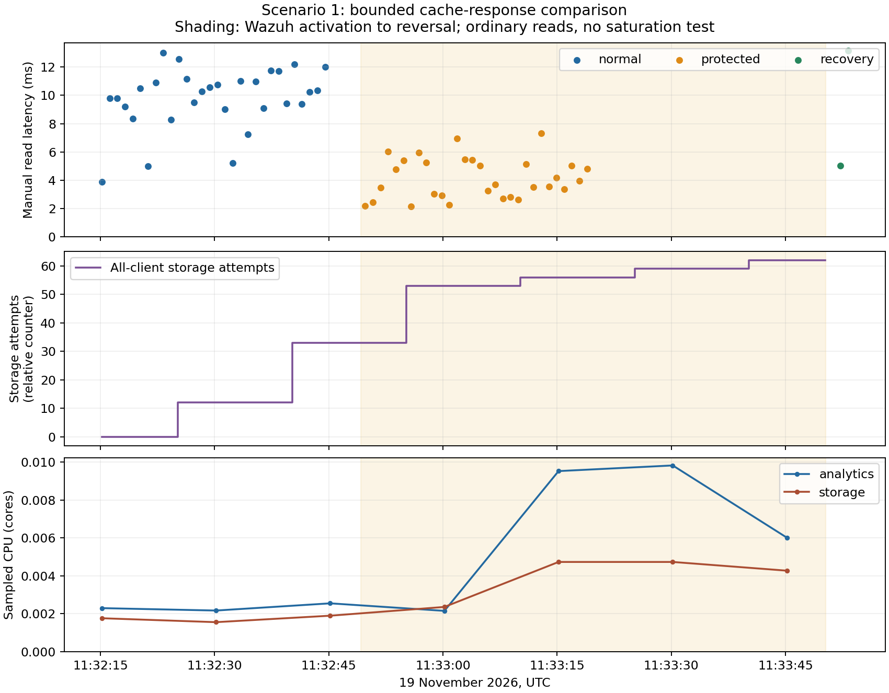

# Scenario 1: availability protection

[Project entry point](../../../README.md)

## Mechanism and assumptions

A client can reach Analytics through its NodePort. Excessive queries may compete
with legitimate reads for finite application/Storage resources. The attacker
model does not grant SSH, Incus administration or direct database access.

Flask-Limiter rejects excess `GET /average` requests before Storage access:
5 requests per moving second, keyed by the source address Analytics observes.
Budgets are in memory and local to one process. Kubernetes address translation
can group clients; HTTP 429 does not prove malicious intent.

Wazuh rule `100121` correlates ten HTTP 429 access-log events from one observed
source within 60 seconds. The local response authorizes a 60-second cache lease
on the node hosting Analytics. It does not block an IP. Analytics keeps rate
limiting active and enforces lease expiry itself. Cached statistics are reused
for up to 5 seconds; a failed refresh can use explicitly labelled data up to
10 seconds old, otherwise the request fails.

An additional path evaluates `AnalyticsClientImpact`: repeated rejections,
client mean latency above 100 ms, sufficient samples, healthy scrape targets
and no recent protection. Alertmanager forwards it through the authenticated
bridge; Wazuh rule `100150` invokes the same scoped response. The bridge checks
that the firing episode exists in Prometheus before writing its audit event.

## Demonstrate and verify

```bash
bash scripts/scenarios/01-dos/demo/show-dos-flow.sh --preflight-only
bash scripts/scenarios/01-dos/demo/show-dos-flow.sh --pause
```

The flow creates an isolated temporary Pod without rate limiting for one warm-up
and 15 measured reads. Production remains protected. It removes the temporary
Deployment and waits for its uniquely labelled Pods to disappear before taking
protected-run snapshots.

The protected phase has a fixed maximum of 77 manual reads: 30 normal,
15 admission checks, 30 cached and 2 recovery reads. It retains HTTP bodies,
latency, metric snapshots, the Wazuh lease, response records and indexed alerts.
The evaluator discovers installed response names and lease mounts, accepts
legacy metric prefixes, and fails if the cluster changes unexpectedly.

Optional state-scope check:

```bash
python3 scripts/scenarios/01-dos/record-replica-scope.py
```

This uses temporary Pods and a labelled fixture lease on one node. It is not a
second Wazuh activation or a capacity test. `show-dos-flow.sh --replicas` invokes
that same retained evaluator. All temporary resources have explicit cleanup.

## Retained final observations

The current flow was repeated successfully on 22 November 2026. Both comparison
windows admitted 48 requests across manual/background clients. The 30 manual
normal reads had no cache hits; the 30 protective reads had 24 hits and six
refreshes. Mean/p95 latency changed from 19.809/46.626 ms to 5.706/10.529 ms.
Storage HTTP attempts fell from 48 to six (87.5%). The maximum returned age was
4.434 seconds. Two recovery reads returned normal, uncached HTTP 200 responses.
Production specs, Pod identities and restart counts remained unchanged.

The [complete final flow](../../../evidence/scenarios/01-dos/demo-flow-20261122T130556Z-102201/flow.log)
and its `protected-evaluation/` directory retain the raw evidence. A cache reply
is not required on every read: the five-second TTL deliberately causes refreshes.
The flow now verifies cache use and lower Storage work per admitted request
instead of incorrectly requiring 100% manual cache hits.

The [final validation report](../../final-validation.md) also covers the separate
[1/2/4 replica study](../../../tests/scalability/README.md).

### Earlier paired observations

The 19 November 2026 paired run used the same image, limits, dataset and
admission policy. Normal and cached windows each observed 42 admitted HTTP 200
responses across manual/background clients.

| Phase | Manual reads | Cached replies | Manual mean | Manual p95 | All-client Storage attempts |
|---|---:|---:|---:|---:|---:|
| Normal | 30 | 0 | 9.771 ms | 12.400 ms | 42 |
| Protective cache | 30 | 30 | 4.154 ms | 6.536 ms | 6 |
| Recovery | 2 | 0 | 9.094 ms | Not estimated | 3 |

Storage HTTP attempts fell by 85.7% in these two comparison windows. This counter
measures attempted HTTP calls, not an exact count of SQLite queries. Background
traffic performed the six refreshes; cache hits do not imply zero Storage work.
The largest returned age was 4.771 seconds. The 15-request admission check and
linked `100121`/`100130` records verified activation and reversal.

| Retained evidence | Purpose |
|---|---|
| [Comparison summary](../../../evidence/scenarios/01-dos/case1-cache-20261119T113214Z/summary.json) | Original observations, boundaries and linked response |
| [Final assessment](../../../evidence/scenarios/01-dos/case1-final-20261119T112749Z/assessment.json) | HTTP/SQLite fixtures, resource context and validation |
| [Replica summary](../../../evidence/scenarios/01-dos/replica-scope-20261119T113438Z/summary.json) | One/two-replica state visibility and cleanup |
| [Post-recovery baseline](../../../evidence/baseline-20261119T113606Z/summary.json) | Normal low-rate client/resource observations |
| [Bridge evidence](../../../evidence/alert-bridge/20261119T214023Z/summary.json) | Labelled alert delivery and the real response path |



The HTTP/SQLite fixtures also checked changed statistics, bounded freshness and
slow Storage behaviour using temporary data, separate from the live read-only
trial. Bridge fixtures validate routing and action; they do not establish that
an attack caused client degradation.

## Scalability and residual risk

One source can encounter separate budgets in different replicas. Cache values
and refresh locks are per process; leases are node-local and do not follow all
rescheduled Pods. Metrics must be attributed to a specific replica before
subtracting counters. SQLite/local-path storage and the shared VM remain common
dependencies. Rejection itself still costs resources, and other application
endpoints are outside this control.

The results establish bounded policy enforcement, reduced dependency work and
recovery. They do not establish overload resistance, DDoS prevention, linear
speedup or multi-host fault tolerance. The low-rate replica check shows state
scope rather than throughput gain. Thresholds are laboratory policy choices.
