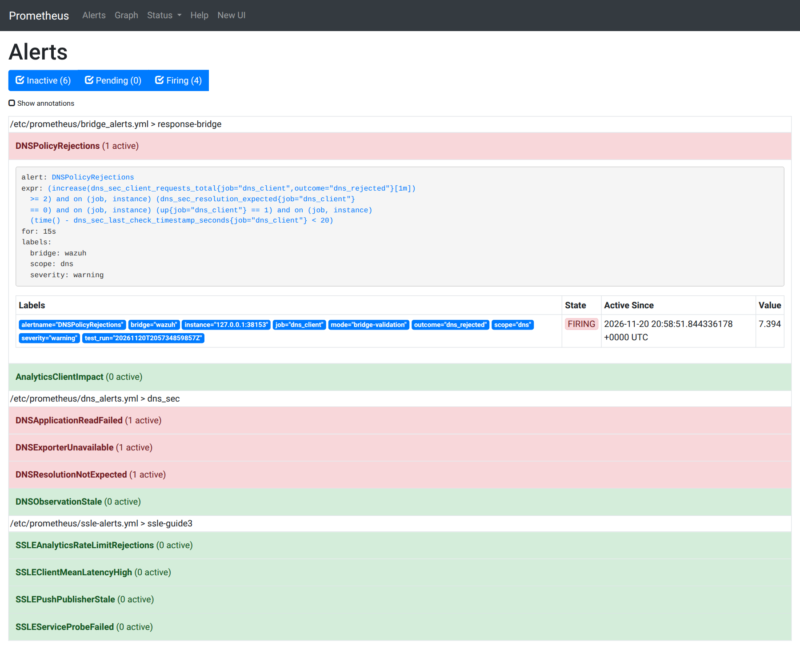

# Scenario 2: DNS integrity and guarded reads

[Project entry point](../../../README.md)

## Mechanism and assumptions

The dependency name is `analytics.lab.test`; its approved lab address is
`10.255.255.74`. The client rejects unexpected DNS answers before making an
application HTTP request, checks the actual peer address and exposes outcome,
freshness and request metrics.

The scenario assumes a configuration change can affect the resolver. The flow
makes one controlled edit to `/etc/dnsmasq.d/dns_sec.conf`; it does not demonstrate
an initial exploit, account compromise or network takeover. The fake endpoint
is a labelled HTML page without a credential form.

The approved file is root-owned at `/var/lib/dns_sec/approved.conf`. A separate
root-owned enable marker controls automatic restoration. Wazuh FIM rule
`100141` can dispatch `dns_restore`; rule `100145` covers the startup mismatch
check. The response validates and restores only the approved file, restarts
dnsmasq when needed and records the before/after hashes and triggering alert.

`DNSPolicyRejections` requires repeated policy rejections, an unexpected current
answer, a live exporter and a recent observation. After its 15-second pending
period, Alertmanager can forward it to the bridge and Wazuh rule `100151`.
That path checks the local file; `already_approved` is a valid result when the
unexpected answer came from an isolated fixture rather than a file edit.

## Demonstrate

```bash
bash scripts/scenarios/02-dns-hijacking/demo/stop-dns-protection.sh
bash scripts/scenarios/02-dns-hijacking/demo/show-dns-flow.sh --pause
```

The stopped-agent baseline is intentional and limited to the DNS demo. The flow:

1. Confirms the approved file and original DNS answer.
2. Changes exactly one lab record to `10.171.72.52` and verifies dnsmasq's answer.
3. Observes eight actual client rejections and the policy alert in Prometheus.
4. Runs the startup protection check, requires a new matching restoration audit
   and confirms the original address and a guarded Analytics read.
5. Leaves DNS/Wazuh protection active on success.

If interrupted, restore protection explicitly:

```bash
bash scripts/scenarios/02-dns-hijacking/start-dns-protection.sh
```

Starting the Wazuh service alone is insufficient evidence that an offline edit
was detected. The supplied startup script also calls `dns_restore.py
--check-startup`; that comparison produces the dedicated startup event.

Additional focused checks:

```bash
python3 scripts/scenarios/02-dns-hijacking/evaluate-dns-alert.py
python3 scripts/scenarios/02-dns-hijacking/evaluate-dns-integrity.py
```

The first uses isolated answers and a temporary monitoring target to test the
metric-to-response chain. The second covers policy, real file restoration and
failure/recovery observations. Both retain separate evidence; they are not the
same experiment as the manual DNS-record flow. The optional
`compare-dns-restoration.py --defense-demo` retains its labelled fixture scope.

## Selected evidence

| Run | What it demonstrates |
|---|---|
| [22 November final flow](../../../evidence/scenarios/02-dns-hijacking/demo-20261122T131141Z-106689/flow.log) | Eight guarded rejections, a firing policy alert, audited restoration and successful guarded recovery |
| [21 November terminal flow](../../../evidence/scenarios/02-dns-hijacking/demo-20261121T170553Z-114259/flow.log) | Actual DNS-record change, guarded rejections, policy alert and startup restoration |
| [Metric alert summary](../../../evidence/scenarios/02-dns-hijacking/metric-alert-20261120T161058200248Z/summary.json) | 11 baseline successes, 3 NXDOMAIN results, 8 rejections, 3 recovery successes |
| [Bridge response](../../../evidence/scenarios/02-dns-hijacking/metric-alert-20261120T161058200248Z/response.json) | Matched Wazuh `100151` dispatch; the approved file was already intact |
| [Defensive validation](../../../evidence/scenarios/02-dns-hijacking/final-defensive-20261119T204122Z/summary.json) | Actual restoration, resolver outage and recovery, plus separately labelled offline fixtures |
| [Startup recovery](../../../evidence/scenarios/02-dns-hijacking/startup-recovery-20261120T203944Z/summary.json) | Explicit restoration of an offline mismatch |
| [Short baseline](../../../evidence/scenarios/02-dns-hijacking/baseline-20261119T205708Z/summary.json) | Observed resource and normal-read context |

NXDOMAIN increased a failure counter without causing the policy-rejection alert.
The isolated rejection checks made zero HTTP requests. The final direct flow
also retained the changed/restored DNS answers and the startup command's output.
Old run assumptions remain unchanged inside their raw records.

In the 22 November run, the queued Prometheus bridge episode restored the file
through rule `100151` as protection resumed. The startup check therefore reported
`already_approved`; this run does not independently demonstrate rule `100145`.
The response audit and manager alert match by bridge episode, but their alert IDs
differ. The [final validation report](../../final-validation.md) records this
correlation limitation rather than treating the audit ID as an exact index match.




## Limitations

The client/resolver share one container. Root can alter the baseline, code or
monitoring; this is not root-compromise resistance. Only one configuration file
is restored. Other resolver paths/files and the enable marker require separate
policies and maintenance procedures.

An expected IP is not authenticated service identity. HTTP data is not protected
by TLS here, and DNSSEC is not implemented. DNS failure, unexpected answers and
malicious intent must be distinguished. Two ordinary readers and a short
baseline do not prove scale or availability under host loss. For N similar
clients, a first model is roughly N/5 application reads per second and 10N custom
series; this is a model, not measured fleet capacity.
