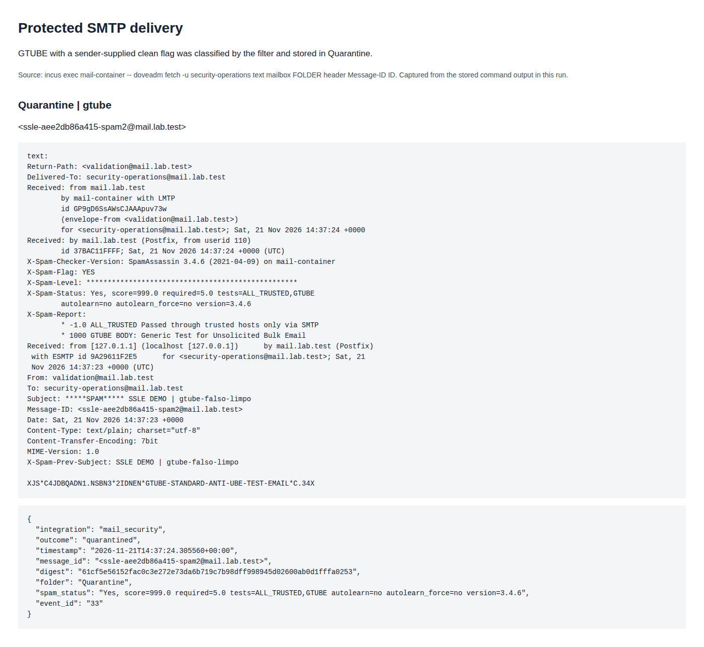

# Scenario 3: mail filtering, firewall containment and service recovery

[Project entry point](../../../README.md)

## Roles and event paths

Postfix accepts loopback SMTP and submissions from the Incus lab subnet. The
demonstration uses a dedicated client. The filter removes sender-controlled
classification headers and asks SpamAssassin to scan the content. Dovecot LMTP
and Sieve deliver classified spam to `Quarantine` and legitimate mail to `INBOX`.
The account is `security-operations@mail.lab.test`. The `smtp-client` instance uses
`10.171.72.60` and connects to `mail-container` at `10.171.72.142:25`.
A Postfix client-access map permits the Incus lab subnet, discovered during installation;
external relay remains disabled. The client address is a topology setting, not a
containment-rule match.

A Maildir observer records actual folder placement, message ID and content hash.
Wazuh receives those JSON records. Prometheus reads the corresponding counters;
`MailQuarantineActivity` requires an estimated increase of at least two quarantine
events in five minutes, maintained for 15 seconds. Alertmanager calls the
authenticated mail gateway, which checks the firing episode against Prometheus
and submits the operational email. Persisted episode state suppresses duplicate
notifications. Wazuh audits submission and actual inbox delivery separately.

```text
SMTP -> Postfix -> SpamAssassin -> Dovecot/Sieve -> INBOX or Quarantine
Maildir observer -> metrics -> Prometheus -> Alertmanager -> mail gateway
Maildir observer -> JSON audit -> Wazuh
Verified repeated quarantine -> Wazuh 100620 -> native firewall-drop -> 20 s timeout
Service probe -> outage audit -> Wazuh -> start SpamAssassin -> verified audit
```

## Wazuh rules and the recovery extension

| Rule | Meaning |
|---|---|
| `100601` | Message confirmed in quarantine |
| `100607` | Quarantine with authenticated, blockable remote source metadata |
| `100620` | Repeated quarantine from the same dynamically observed source within 60 seconds |
| `651` / `652` | Built-in firewall response added / removed, where indexed |
| `100602` | Message confirmed in the operations inbox |
| `100603` | Operator release confirmed |
| `100604` / `100605` | Notification submission failed / SMTP accepted it |
| `100610` | SpamAssassin inactive/failed; request local recovery |
| `100611` | Service started and a local scanner check passed |
| `100612` / `100613` | Recovery failed / suppressed or no longer needed |

The observation timer checks the fixed service about every ten seconds and only
writes facts. The Wazuh response accepts a fresh local outage alert, rechecks
service state, starts only SpamAssassin and verifies a benign local scan. It
records the triggering Wazuh event and observation identifier. A persisted
60-second cooldown limits repeated attempts, including failures. This recovery
has no timed reversal and does not stop the service again after a minute.

This is recovery of protection availability. Spam containment is performed by
the mail stack; a controlled service stoppage alone is not proof of an attack.
The security containment policy reuses the existing native Wazuh `firewall-drop`
command and executable with the endpoint's iptables firewall. It blocks the
source IP across INPUT/FORWARD traffic, not only SMTP. No sender IP is embedded in the rule.
The observer discovers the server's own IPv4 addresses at runtime and marks
loopback, local, unspecified, multicast, link-local and reserved sources as
ineligible for containment. If local-address discovery fails, classification
continues but the source is not eligible for an automatic firewall action.

Postfix supplies `${client_address}` and `${queue_id}` directly to the content
filter. Sender-controlled classification/origin headers are removed before the
scan. The filter signs the observed source, queue ID, message ID, classification
and body hash with a local per-purpose HMAC key. The Maildir observer verifies
the signature before adding `srcip`, `source_ip`, `source_verified` and
`source_blockable` to a quarantine event. The `From` header and unsigned
`Received` headers are not trusted source identities. The key is generated inside the endpoint and excluded
from the submission.

Rule `100620` correlates three verified quarantine events from the same source
within 60 seconds, using `<same_field>source_ip</same_field>`. Different source
addresses have separate event counts. Its Active Response requests
`firewall-drop` locally with `<timeout>20</timeout>`. Wazuh must remain operational to issue the timed delete;
iptables rules themselves do not carry an expiry. The flow verifies both native
actions, the actual INPUT rule, an SMTP timeout and subsequent SMTP success.
Repeated alerts are suppressed for 60 seconds. The old course-guide AlienVault
rule `100100` and its separate 60-second firewall response were retired; the
shared native command was retained. This is a laboratory containment
policy, not a general recommendation to block every sender after three spam emails.

References: [Postfix pipe metadata](https://www.postfix.org/pipe.8.html) and
[Wazuh native firewall response](https://documentation.wazuh.com/current/proof-of-concept-guide/block-malicious-actor-ip-reputation.html).

## Effective Wazuh configuration

On `wazuh-container`, `/var/ossec/etc/rules/mail_rules.xml` contains the following
rules. The maintained source is [wazuh-mail-rules.xml](../../../security/wazuh-mail-rules.xml).

```xml
<rule id="100607" level="7">
  <if_sid>100601</if_sid>
  <field name="source_verified">^yes$</field>
  <field name="source_blockable">^yes$</field>
  <description>A spam message from a verified remote SMTP source eligible for containment was quarantined.</description>
</rule>

<rule id="100620" level="10" frequency="3" timeframe="60" ignore="60">
  <if_matched_sid>100607</if_matched_sid>
  <same_field>source_ip</same_field>
  <description>Repeated quarantined spam from the same verified SMTP source; request a 20-second firewall-drop block.</description>
</rule>
```

`100607` refines the existing quarantine rule `100601`. `source_verified=yes`
requires a valid signature from the local filter; `source_blockable=yes` requires
an eligible remote IPv4 source. `100620` groups those records by `source_ip`,
requires three events within 60 seconds and suppresses repeated firings for
60 seconds through `ignore`. The sender IP is read from each event, not from a
literal in either rule. The normal `.60` client address and the `.61` validation
address are test topology settings.

The event fields have distinct roles:

| Field | Purpose |
|---|---|
| `source_ip` | Observed connection address used to correlate repeated quarantine |
| `srcip` | The same verified address passed to the native firewall response |
| `source_verified` | Indicates that locally signed connection metadata was verified |
| `source_blockable` | Excludes protected source addresses from automatic containment |

In `/var/ossec/etc/ossec.conf`, the existing native command definition is reused:

```xml
<command>
  <name>firewall-drop</name>
  <executable>firewall-drop</executable>
  <timeout_allowed>yes</timeout_allowed>
</command>
```

The current response is below. Its maintained fragment is
[wazuh-mail-smtp-config.xml](../../../security/wazuh-mail-smtp-config.xml).

```xml
<active-response>
  <disabled>no</disabled>
  <command>firewall-drop</command>
  <location>local</location>
  <rules_id>100620</rules_id>
  <timeout>20</timeout>
</active-response>
```

`location=local` runs the existing `/var/ossec/active-response/bin/firewall-drop`
on `mail-container`, the agent that produced the quarantine event. The native
response reads `srcip`, applies an IP-wide INPUT/FORWARD block through iptables
and receives a timed delete from Wazuh. The configured timeout is 20 seconds;
observed removal also includes scheduling and polling delay.

Notification and mitigation use separate policies:

| Policy | Trigger | Action |
|---|---|---|
| Prometheus `MailQuarantineActivity` | Estimated increase of at least two quarantines in five minutes, maintained for 15 s | Alertmanager calls the gateway to send the operational email |
| Wazuh `100620` | Three eligible verified quarantines from the same IP within 60 s | Native `firewall-drop`, timeout 20 s |
| Wazuh `100610` | Fresh observation that SpamAssassin is inactive/failed | Start the fixed service and verify scanning; no timed reversal |

The source-IP response does not wait for the operational email or the
Prometheus alert. The service-recovery response addresses a separate availability
failure, while quarantine and firewall containment address the spam scenario.

## Retired course-guide configuration

The former AlienVault rule `100100` and its `firewall-drop` response with a
60-second timeout were removed from the current VM. The unreferenced
`etc/lists/blacklist-alienvault` registration and its text/CDB files were also
retired. The shared command definition and the native response audit rules
`651`/`652` remain in use.

The cleanup left one `firewall-drop` command definition and one response,
linked to `100620` with timeout 20. Original configuration and list files were
preserved under `/root/retired-reputation-u7c1rivy/` inside `wazuh-container`.
The [retirement report](../../../evidence/validation-20261122-dynamic-source/firewall-retirement-report.json)
records the removed and remaining configuration. Earlier evidence keeps the
configuration recorded at the time; it should be interpreted with its run date.

## Install and demonstrate

For the existing mail deployment:

```bash
bash scripts/scenarios/03-spam/install-smtp-containment.sh
bash scripts/scenarios/03-spam/demo/show-mail-flow.sh --preflight-only
bash scripts/scenarios/03-spam/demo/show-mail-flow.sh --pause
```

For a fresh mail component in the existing Incus/Wazuh lab, use
`install-mail.sh base`, `install-mail.sh filter`, then `install-mail-security.sh`.
The final installer includes service recovery and SMTP containment. Secrets
are generated inside containers and are not shipped with this source. Configuration changes are backed up and
validated; rule tests include the remote-agent location prefix.

The Bash flow performs eight stages after preflight:

1. Disable only the SMTP filter override.
2. Submit GTUBE and prove its unfiltered arrival in `INBOX`.
3. Restore the original Postfix configuration.
4. Verify a legitimate message and three filtered GTUBEs, including a forged
   `X-Spam-Flag: NO` header. Require native firewall-drop activation, failed SMTP,
   automatic timeout removal and successful legitimate delivery from that same IP.
   Each quarantine must first be acknowledged by Wazuh as an eligible event; the
   next test message is not sent before that acknowledgement.
5. Observe the actual Prometheus alert in `firing`.
6. Verify the operational inbox notification, webhook authentication,
   duplicate suppression and linked Wazuh events.
7. Keep the filter configured and Wazuh active, stop SpamAssassin, and require
   correlated `100610`/`100611` records plus a working scanner. Submit a new
   GTUBE to `Quarantine` and a legitimate message to `INBOX`.
8. Verify the original Postfix hash. `--release` additionally demonstrates an
   authorized idempotent release of one fixture.

GTUBE is a harmless known-positive fixture. Its arrival in the unfiltered inbox
is the comparison baseline, not a classification as legitimate mail. The
service-recovery policy does not interrupt this baseline because SpamAssassin
remains active while the SMTP filter override is disabled.

If automatic recovery fails, cleanup may start the scanner manually to leave the
lab operational. The flow remains failed and labels that cleanup manual; it
cannot count as Wazuh mitigation evidence.

## Final sequential live demonstration

Run `bash-20261122T122418Z-5bbf211e9927` completed with exit code 0 after the
flow began waiting for Wazuh acknowledgement after each controlled quarantine.
The first two messages generated `100607`; the third generated `100620`, event
`1795350415.16100343`. Native firewall-drop added the source-IP DROP, SMTP failed
during the block, and Wazuh removed it automatically. The observed remaining
block interval was 20.902 s with a configured timeout of 20 s. A new legitimate
message from the same source reached INBOX after removal.

The full flow also verified the Prometheus operational notification, webhook
authentication/deduplication and the separate automatic SpamAssassin recovery.
Cleanup restored the original master.cf hash. The endpoint services/timer were
active, the SMTP queue was empty and no test DROP remained.

- [Complete flow](../../../evidence/scenarios/03-spam/bash-20261122T122418Z-5bbf211e9927/flow.log)
- [Per-message Wazuh acknowledgements](../../../evidence/scenarios/03-spam/bash-20261122T122418Z-5bbf211e9927/smtp-containment/quarantine-acknowledgements.jsonl)
- [Firewall/SMTP result](../../../evidence/scenarios/03-spam/bash-20261122T122418Z-5bbf211e9927/smtp-containment/summary.json)
- [Native add/delete audit](../../../evidence/scenarios/03-spam/bash-20261122T122418Z-5bbf211e9927/smtp-containment/native-firewall-actions.json)
- [Manager response alerts](../../../evidence/scenarios/03-spam/bash-20261122T122418Z-5bbf211e9927/smtp-containment/wazuh-native-response-events.jsonl)
- [Final state](../../../evidence/scenarios/03-spam/bash-20261122T122418Z-5bbf211e9927/final-state.json)
- [123 isolated tests](../../../evidence/validation-20261122-mail-flow-synchronization/tests.txt)

## Diagnosing a missing firewall block

The run `bash-20261122T120840Z-edf0777a6167` confirmed three actual quarantines
from `10.171.72.60`. Each produced `100607`, but the manager log contained no
`100620` for that run and the native response log contained no matching action.
The demonstrator correctly failed instead of treating quarantine as proof of
firewall containment. The approved Postfix filter was restored by cleanup. The original
[failed flow](../../../evidence/validation-20261122-mail-flow-synchronization/failed-flow.log)
and [manager records](../../../evidence/validation-20261122-mail-flow-synchronization/failed-manager-events.jsonl)
are retained alongside the [diagnosis and checks](../../../evidence/validation-20261122-mail-flow-synchronization/checks.json).

The same captured records matched `100620` in an isolated
[wazuh-logtest session](../../../evidence/validation-20261122-mail-flow-synchronization/isolated-replay.log);
fresh bounded SMTP checks also triggered it. The exact reason for the missed
live correlation was not established. A passing rule test therefore does not
replace live manager, firewall and connection evidence.

Regression checks exercise the actual Bash comparison phase: they
[fail against the original flow](../../../evidence/validation-20261122-mail-flow-synchronization/regression-before.txt)
and [pass against the updated flow](../../../evidence/validation-20261122-mail-flow-synchronization/regression-after.txt).
The previous flow sent the next message after Maildir confirmation. The current
flow also waits for the corresponding Wazuh `100607`/`100620` acknowledgement,
with the exact Message-ID, verified source and source eligibility. This makes
the comparison sequential at the security-event boundary. It is a demonstration
sequencing fix, not a claim that every concurrent ingestion case is resolved.
The policy still requires actual rule `100620`, the native action, a visible DROP,
a failed SMTP connection and automatic recovery before reporting success.

New runs retain `smtp-containment/quarantine-acknowledgements.jsonl`. If a block
is not observed, the helper additionally saves `failure-summary.json`, the
matching manager records, native response records and a firewall snapshot.
`stage=detection` means `100620` was absent; `stage=response_or_observation` means
the trigger existed but the expected live DROP was not observed. An error remains
a failed demonstration, and no manual firewall invocation counts as mitigation.

## Earlier alternate-source demonstration

Run `bash-20261122T115723Z-0a058155fc73` completed with exit code 0 using
`10.171.72.61`, rather than the client's normal `10.171.72.60`. The Incus client
address was changed temporarily for the test and restored afterwards. Neither
the Wazuh rule nor the firewall response was edited for the alternate IP.
The flow discovered the connection source automatically during preflight.

| Observation | Actual result |
|---|---|
| SMTP source observed | `10.171.72.61` |
| Rule `100607` | Requires verified/blockable metadata; contains no sender-IP literal |
| Correlation | Three quarantines from the same source within 60 seconds |
| Detection | `100620`, event `1795348689.12028780` |
| Native response | `firewall-drop` add/delete refer to that event and `srcip=10.171.72.61` |
| Network effect | SMTP timed out while the source DROP was present |
| Automatic removal | 20 s configured; first observed blocked to first absent poll: 20.895 s |
| After removal | SMTP banner `220`; legitimate message delivered to INBOX |
| Other flow checks | Quarantine, operational notification and scanner recovery passed |
| Final state | No test DROP remains; queue empty; services active; client restored to `.60` |

The observed interval includes polling and response scheduling. This is not a
precise insertion-to-deletion duration or a timing guarantee. The scenario uses
IPv4 SMTP on the lab subnet. For a real relay/proxy deployment, the visible IP
can identify a shared relay or NAT, rather than an individual mail origin.

Evidence:

- [Full flow and temporary-address restoration](../../../evidence/scenarios/03-spam/bash-20261122T115723Z-0a058155fc73/client-address-test.log)
- [Automatically observed source](../../../evidence/scenarios/03-spam/bash-20261122T115723Z-0a058155fc73/smtp-client-address.txt)
- [Installed rules without a fixed sender IP](../../../evidence/scenarios/03-spam/bash-20261122T115723Z-0a058155fc73/smtp-containment/installed-mail-rules.xml)
- [Containment summary](../../../evidence/scenarios/03-spam/bash-20261122T115723Z-0a058155fc73/smtp-containment/summary.json)
- [Native correlated actions](../../../evidence/scenarios/03-spam/bash-20261122T115723Z-0a058155fc73/smtp-containment/native-firewall-actions.json)
- [Manager alerts 651/652](../../../evidence/scenarios/03-spam/bash-20261122T115723Z-0a058155fc73/smtp-containment/wazuh-native-response-events.jsonl)
- [Failed SMTP](../../../evidence/scenarios/03-spam/bash-20261122T115723Z-0a058155fc73/smtp-containment/smtp-blocked.json) and [recovered SMTP](../../../evidence/scenarios/03-spam/bash-20261122T115723Z-0a058155fc73/smtp-containment/smtp-recovered.json)
- [Final state and restored client address](../../../evidence/scenarios/03-spam/bash-20261122T115723Z-0a058155fc73/final-state.json)

## Earlier fixed-source firewall-containment demonstration

This earlier run still restricted the detection rule to the original test-client
address; it proves the native response, not dynamic source selection.

The complete flow `bash-20261122T114355Z-9344a3ef54b1` completed successfully
on 22 November 2026. It sent eight controlled test messages plus one operational
notification. All test submissions used the dedicated client IP; the operational
notification used local SMTP.

| Observation | Actual result |
|---|---|
| Unfiltered GTUBE | One INBOX copy |
| Filtered GTUBE samples | Three Quarantine copies before containment |
| Sender-supplied `X-Spam-Flag: NO` | Removed; the message was classified and quarantined |
| Source attribution | Signed Postfix connection IP `10.171.72.60` and distinct queue IDs |
| Correlation | Third verified quarantine generated `100620`, event `1795347882.11987526` |
| Native response | `firewall-drop` add and delete refer to the same triggering event |
| Manager response audit | Native rules `651` and `652` both observed |
| During containment | INPUT/FORWARD DROP entries present; SMTP connection timed out |
| Automatic removal | Timeout configured as 20 s; first observed blocked to first absent poll: 21.222 s |
| After containment | SMTP banner `220`; a new legitimate message reached INBOX |
| Scanner recovery | Separate `100610` -> `100611` test completed |
| Final state | Six services/timer active, queue empty, no test DROP entry, original master.cf hash restored |

The 21.222-second observation includes native response scheduling and polling.
It is not an exact measurement of firewall-rule insertion time or a timing SLA.
This run proves bounded lab behavior, not spam-classifier accuracy or DoS capacity.
The older runs below remain historical evidence and used the previous loopback setup.

Evidence for this run:

- [Complete terminal flow](../../../evidence/scenarios/03-spam/bash-20261122T114355Z-9344a3ef54b1/flow.log)
- [Containment summary and polling times](../../../evidence/scenarios/03-spam/bash-20261122T114355Z-9344a3ef54b1/smtp-containment/summary.json)
- [Effective response configuration after the run](../../../evidence/scenarios/03-spam/bash-20261122T114355Z-9344a3ef54b1/smtp-containment/effective-response-after.json)
- [Package-owned native executable](../../../evidence/scenarios/03-spam/bash-20261122T114355Z-9344a3ef54b1/smtp-containment/native-executable.txt)
- [Native correlated add/delete](../../../evidence/scenarios/03-spam/bash-20261122T114355Z-9344a3ef54b1/smtp-containment/native-firewall-actions.json)
- [Native manager alerts 651/652](../../../evidence/scenarios/03-spam/bash-20261122T114355Z-9344a3ef54b1/smtp-containment/wazuh-native-response-events.jsonl)
- [Blocked firewall snapshot](../../../evidence/scenarios/03-spam/bash-20261122T114355Z-9344a3ef54b1/smtp-containment/iptables-blocked.txt)
- [SMTP failure](../../../evidence/scenarios/03-spam/bash-20261122T114355Z-9344a3ef54b1/smtp-containment/smtp-blocked.json) and [successful reconnection](../../../evidence/scenarios/03-spam/bash-20261122T114355Z-9344a3ef54b1/smtp-containment/smtp-recovered.json)
- [Stored-message index](../../../evidence/scenarios/03-spam/bash-20261122T114355Z-9344a3ef54b1/messages/index.tsv)
- [Final services, firewall, Postfix and queue](../../../evidence/scenarios/03-spam/bash-20261122T114355Z-9344a3ef54b1/final-state.json)

## Earlier live observations before firewall containment

Run `bash-20261121T180648Z-b3fa0adce195` completed with `--release`, exit code 0,
seven test messages and one operational notification. Twelve matching Wazuh
manager records were independently found in the indexer.

| Observation | Recorded result on 21 November 2026, UTC |
|---|---|
| Start of stop command | 18:08:22.367; Wazuh stayed active |
| Probe observed stopped scanner | 18:08:27.128 |
| Detection | `100610`, event `1795284507.13423834` |
| Verified service and scan | 18:08:29.041 |
| Outcome | `100611`, event `1795284509.13424438` |
| Observation -> verified recovery | 1.913 seconds |
| Stop command start -> verified recovery | 6.674 seconds |
| Post-recovery GTUBE / legitimate message | `Quarantine` / `INBOX`, exactly one copy each |
| Final runtime | Six services/timer active, scanner check passed, SMTP queue empty |
| Postfix configuration | Original hash unchanged; `spamassassin:filter` restored |

The 6.674 seconds include stop-command execution and probe scheduling; this is
one controlled observation, not an exact outage duration or recovery guarantee.
The old 14:36 run supplies the stored-message/dashboard evidence views and
predates automatic service recovery. Its eight indexed events are separate.

| Evidence | Purpose |
|---|---|
| [New terminal flow](../../../evidence/scenarios/03-spam/bash-20261121T180648Z-b3fa0adce195/flow.log) | Complete comparison, recovery and release |
| [Recovery summary](../../../evidence/scenarios/03-spam/bash-20261121T180648Z-b3fa0adce195/recovery-summary.json) | Times and acceptance checks |
| [Linked manager events](../../../evidence/scenarios/03-spam/bash-20261121T180648Z-b3fa0adce195/wazuh-recovery-events.jsonl) | Detection/response for one observation |
| [Indexer records](../../../evidence/scenarios/03-spam/bash-20261121T180648Z-b3fa0adce195/indexed-alerts.json) | Twelve matching indexed events |
| [Message evidence index](../../../evidence/scenarios/03-spam/bash-20261121T180648Z-b3fa0adce195/messages/indice.tsv) | Dovecot content, folder searches and audit files |
| [Final state](../../../evidence/scenarios/03-spam/bash-20261121T180648Z-b3fa0adce195/final-state.json) | Runtime verification after cleanup |



## Limits and remaining security work

The current client is a distinct Incus network endpoint; the older retained runs
used loopback and do not prove the new containment behavior. GTUBE and a few
legitimate fixtures do not measure detection
accuracy or false-positive rates on a representative mail corpus. No sustained
mail-volume benchmark or mail high availability is claimed.

The recovery trigger covers inactive/failed service states, not an active but
unresponsive scanner. Wazuh and its observation path must remain operational;
persistent root control can disable them. The privileged operator controls
release. Shared/NAT addresses and classifier mistakes can affect legitimate
senders. Expiration of a temporary block permits later attempts; this policy
does not establish that the sender has become trustworthy.
